<div align="center">



[](https://www.linkedin.com/in/ahmadmashal03/)
[](https://github.com/ahmadmeshaal)


</div>

## `ahmad@dev:~$ whoami`

```yaml
name: Ahmad Meshaal
location: Amman, Jordan
role: Software Engineer | Full Stack Developer
education: B.Sc. Software Engineering, Jordan University of Science and Technology (2022–2026)
currently_learning: [Laravel, REST APIs, Backend Architecture]
training:
  - Orange Coding Academy
  - 42 Amman (CORE)
  - Flutter Training at DOT Jordan (completed)
interests: [Backend Development, Clean Code, Product Engineering]
```

## `ahmad@dev:~$ cat stack.json`

<div align="center">

**Languages**


**Frameworks**


**Databases & tools**


</div>

## `ahmad@dev:~$ ls projects/`

<table>
<tr>
<td width="50%" valign="top">

### 📚 [EduTrack](https://github.com/ahmadmeshaal/EduTrack)

Teacher-focused education management web app built with a team of five. Includes students, courses, assignments, quizzes, exams, grades, and teacher-specific course access.

`JavaScript` `HTML` `CSS` `JSON Server`

**[Explore repository →](https://github.com/ahmadmeshaal/EduTrack)**

</td>
<td width="50%" valign="top">

### 🎯 Taqaddomi · In development

Goal-tracking and community platform designed around **journeys**, **habits**, progress entries, streaks, and optional community sharing.

`Laravel` `React` `MySQL` · planned stack

*Repository link will be added when public.*

</td>
</tr>
<tr>
<td width="50%" valign="top">

### 🌸 Perfume E-commerce Data Pipeline

Python data collection pipeline that assembled **1,582 perfume records** with scent profiles, note pyramids, and metadata for an e-commerce demo backed by MySQL.

`Python` `BeautifulSoup` `MySQL`

*Repository link not provided.*

</td>
<td width="50%" valign="top">

### 🧩 Laravel Portfolio Challenge

Practicing Eloquent one-to-many relationships, migrations, CRUD, developer profiles, and Blade layouts in Laravel 12.

`Laravel 12` `PHP` `Blade` `MySQL`

*Learning project.*

</td>
</tr>
</table>

## `ahmad@dev:~$ git log --stat`

<div align="center">


</div>

## `ahmad@dev:~$ render --contributions --3d`

<div align="center">

<!-- Generated daily by .github/workflows/profile-3d.yml -->


<sub>If the 3D graph is missing, enable GitHub Actions and run the workflow once.</sub>

</div>

## `ahmad@dev:~$ echo $NEXT_STEP`

> Building practical products, learning in public, and getting better with every commit.

<div align="center">

**Open to entry-level Software Engineering, Backend, and Full Stack opportunities.**


</div>
